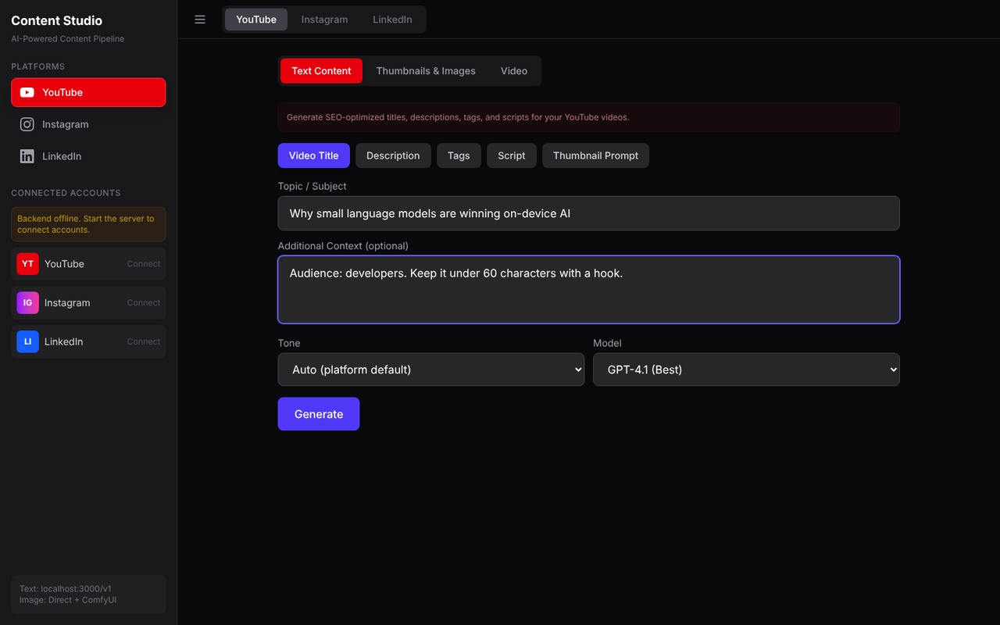

# Shorts Content Pipeline

A local studio for producing and publishing short-form social content: an LLM writes the
copy, a diffusion model makes the visuals, and one click publishes to YouTube, Instagram
or LinkedIn.

<!-- showcase -->


**Text-to-image, then image-to-image.** A Z-Image Turbo render and a Flux.2 Klein edit of it
(subject swapped, scene and lighting kept):


Consistent-character outfit edits from one source image:


*All images above were generated locally by this pipeline.*

## Why

Posting the same idea across three platforms means three tones, three formats and three
publishing APIs. This project puts the whole loop (write → illustrate → publish) behind one
UI and one FastAPI service, with platform-specific prompt templates so the copy fits each
channel.

## Architecture

```
React + Vite UI (localhost:5173)
        │  REST + streaming
        ▼
FastAPI backend (localhost:8000)
  ├── /api/text   → OpenAI-compatible LLM (streamed), per-platform prompt templates
  ├── /api/image  → text-to-image (Z-Image Turbo) and image-to-image (Flux.2 Klein)
  │                  via a running ComfyUI server, or in-process with ComfyUI's libraries
  ├── /api/auth   → OAuth for YouTube (Google), Instagram (Meta), LinkedIn
  └── /api/video  → placeholder for the video stage
        │
        ▼
Publishers: YouTube Data API, Instagram Graph API, LinkedIn API
```

| Path | Purpose |
|------|---------|
| `backend/services/openai_service.py` | Streaming and blocking text generation against any OpenAI-compatible endpoint |
| `backend/services/prompt_templates.py` | System prompts per platform and content type; picks a heavy or light model |
| `backend/services/comfyui_service.py` | Submits workflows to ComfyUI, polls for results, uploads input images |
| `backend/services/image_service.py` | Direct in-process inference path when no ComfyUI server is running |
| `backend/workflows/` | Z-Image Turbo (t2i) and Flux.2 Klein (i2i) workflow builders |
| `backend/services/*_publisher.py` | YouTube upload/update, Instagram image and carousel posts, LinkedIn text and image posts |
| `frontend/src/` | Text and image generators, account connection and per-platform panels |

## Tech stack

Python, FastAPI, pydantic-settings, httpx · ComfyUI (Z-Image Turbo, Flux.2 Klein) · React,
TypeScript, Vite · OAuth 2.0 for Google, Meta and LinkedIn.

## Quickstart

```bash
cp .env.example .env        # fill in the values you need
./start.sh                  # or start.bat on Windows
```

`start.sh` installs backend requirements, starts the API on port 8000 and the frontend on
port 5173. To run them separately:

```bash
cd backend && pip install -r requirements.txt && uvicorn main:app --reload --port 8000
cd frontend && npm install && npm run dev
```

Image generation needs either a ComfyUI server at `COMFYUI_URL` with the models below, or
ComfyUI's libraries and weights available locally (`MODEL_BASE_PATH`).

## Configuration

All settings come from `.env` (see `.env.example`):

- **LLM:** `OPENAI_API_BASE`, `OPENAI_API_KEY`, `OPENAI_MODEL_HEAVY`, `OPENAI_MODEL_LIGHT`
- **Images:** `COMFYUI_URL`, `MODEL_BASE_PATH`, `DIFFUSION_MODEL_T2I`, `DIFFUSION_MODEL_I2I`, `VAE_T2I`, `VAE_I2I`, `TEXT_ENCODER`, `OUTPUT_DIR`
- **Publishing:** `GOOGLE_CLIENT_ID/SECRET/REDIRECT_URI`, `META_CLIENT_ID/SECRET/REDIRECT_URI`, `LINKEDIN_CLIENT_ID/SECRET/REDIRECT_URI`
- **App:** `SECRET_KEY`, `FRONTEND_URL`

## Design decisions

- **Any OpenAI-compatible endpoint** for text, so the same code runs against a hosted API or
  a local server; a heavy model for long-form scripts and a light model for captions.
- **Two image backends**: ComfyUI over HTTP when a server is running, in-process inference
  otherwise, behind the same `/api/image` contract.
- **Platform publishers are thin modules** with one function per post type, which keeps each
  API's quirks (Instagram's container-then-publish flow, LinkedIn's asset upload) isolated.

## Limitations and roadmap

- The video stage is a placeholder; next step is assembling script, images and TTS into a
  vertical video for YouTube Shorts and Reels.
- OAuth tokens are kept locally for a single user; no multi-account support.
- No scheduling or analytics yet, and no automated tests.

## License

MIT
